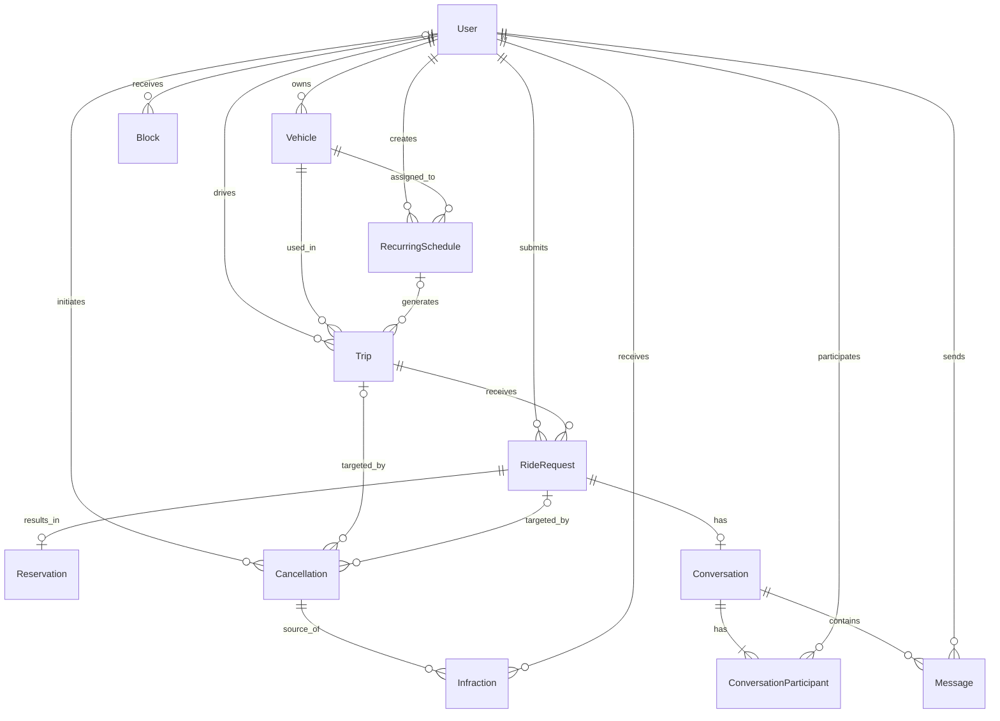

# Bora Lá UTFPR

Plataforma comunitária de caronas para estudantes e servidores da UTFPR —
campus Guarapuava. O projeto aproxima pessoas que já farão um trajeto de ida ou
volta do campus de quem precisa de transporte, facilitando a organização de
viagens gratuitas e reduzindo a dependência do transporte coletivo.

## Autores

- [Gabriel Afinovicz](https://github.com/Gabriel-Afinovicz)
- [Péricles Expedito Andrade](https://github.com/Pericles3322)
- [Eder Murilo de Morais](https://github.com/ederzin13)

## Documentação

- [Requisitos do produto](docs/prd.md)
- [Arquitetura e especificação técnica](docs/architecture.md)
- [Design System](docs/design-tokens.md)
- [Checklist da disciplina](docs/checklist.md)

[Protótipo no Stitch](https://stitch.withgoogle.com/projects/1301683431746634861),
informado pela equipe. Acesso público pendente de verificação.

[Cópia no Figma](https://www.figma.com/design/AP057SPP6qVdCtTnHaRrBs/Sem-t%C3%ADtulo?node-id=0-1).
Navegação por botões e acesso público em janela anônima confirmados pela equipe.

## Funcionalidades planejadas

- Cadastro e confirmação de contas por e-mail.
- Cadastro de veículos e publicação de viagens avulsas ou recorrentes.
- Busca de caronas próximas ao local informado.
- Solicitação de vaga e aprovação pelo motorista.
- Conversas entre motorista e passageiro.
- Confirmação de presença, cancelamento e conclusão das viagens.
- Avisos e bloqueios progressivos por cancelamentos tardios repetidos.

As regras completas e os critérios de aceite estão descritos no
[PRD](docs/prd.md). As histórias permanecem em `Draft` enquanto aguardam a
leitura e a aprovação de todos os integrantes.

## Modelagem de dados

Modelo definido na [arquitetura](docs/architecture.md):

## Tecnologias

- **Frontend:** Angular 21 com componentes standalone e modo zoneless.
- **Estado da interface:** Signals.
- **Dados do MVP:** json-server.
- **Dados da aplicação final:** Supabase (PostgreSQL e Auth).
- **Interface:** PrimeNG 21, com os tokens visuais da equipe.
- **Mapas e rotas:** Leaflet, OpenStreetMap e OpenRouteService via Edge Function na E3.
- **Qualidade:** Vitest, ESLint/angular-eslint e Prettier.
- **Distribuição:** aplicação web responsiva e instalável como PWA; hospedagem planejada na Vercel.

## Aplicação em produção

O endereço público será incluído após a configuração do deploy em uma etapa
posterior do projeto.

## Execução local

O projeto ainda está na fase de concepção e planejamento. As instruções para
instalação e execução serão adicionadas quando a estrutura Angular for criada
pelo fluxo `/utf-setup`.

## Telas da aplicação

As imagens serão adicionadas depois da criação e aprovação do protótipo e da
implementação das primeiras interfaces.
