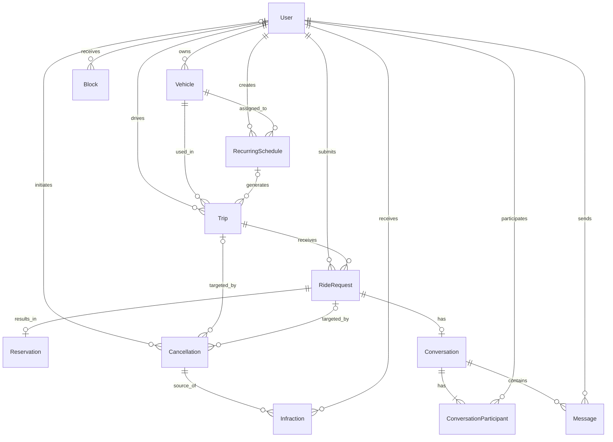

# 🛠️ Architecture / SSD

**Projeto:** Bora Lá UTFPR
**Versão:** 1.0.0 · entrevista concluída; aguardando revisão e commit da equipe
**Última atualização:** 2026-10-21

> 🤖 **O `prd.md` responde _o quê_ o produto faz. Este responde _onde as coisas
> moram e como se chamam_.** Detalhe de tela — rota, componente, contrato —
> **não** se decide aqui: isso é trabalho da spec de cada história.
> (No texto oficial da disciplina este documento é o `ssd.md` — ID31.)
>
> ✍️ **Não preencha na mão:** rode `/utf-architecture` (depois do `/utf-prd`).
> A entrevista decide com você cada seção e garante o que o `/utf-setup` exige:
> **framework do frontend, o BaaS, a estrutura do projeto e como rodar os
> testes.**

---

## 🤖 1. Fontes de Contexto para a IA

> Onde a IDE agêntica busca a verdade. **Isto é o índice; a configuração mora
> nos arquivos** — documento não configura ferramenta.

| Fonte | Onde configurar | Serve para |
| :---- | :-------------- | :--------- |
| Constituição da IA | `.agents/rules/utf-rules.md` (via `CLAUDE.md`) | Regras inegociáveis: fases do SDD, 2 rodadas, revisores distintos, Gitflow |
| Fluxos da IA | `.agents/workflows/` | PRD, backlog, design, architecture, setup, ciclo por Issue, ciclo por tarefa, tutor |
| Agentes (subagentes) | `.agents/agents/` (cascas em `.claude/`, `.cursor/`, `.opencode/`) | Implementador, revisores, auditor final e tutor |
| Ficha da disciplina | `docs/checklist.md` | Regras do projeto, IDs e entregas |
| Protótipo (Figma) | [Bora Lá UTFPR](https://www.figma.com/design/AP057SPP6qVdCtTnHaRrBs/Sem-t%C3%ADtulo?node-id=0-1) | Telas, jornadas e hierarquia visual; acesso público e navegação confirmados pela equipe (ID1) |
| Context7 | configuração MCP da IDE, a verificar no setup | Consulta de documentação; não disponível nesta sessão (ID32) |
| Supabase MCP | configuração MCP da IDE, limitada ao projeto de desenvolvimento | Contexto do schema e das integrações; conexão a verificar no setup (ID32) |
| Skill Angular 21 | catálogo de skills da IDE; instalação e compatibilidade a verificar no setup | Padrões específicos da linha escolhida (ID32) |

O conjunto de MCPs e skill acima foi confirmado como **planejado**, não como
instalado ou conectado. O setup deve verificar a configuração efetiva e indicar
a skill e seu caminho; sem essa verificação, o ID32 não está comprovado.
Documentação oficial é o recurso alternativo quando Context7 estiver indisponível.
Referências: [contexto para IA do Angular](https://angular.dev/ai/develop-with-ai)
e [MCP do Supabase](https://supabase.com/docs/guides/ai-tools/mcp).

---

## 📦 2. Stack Tecnológica

> Definição **estrita**: nenhuma dependência entra sem aparecer aqui. Esta
> seção e o `package.json` contam a mesma história, ou o projeto já se perdeu.
> O que a ficha fixa entra como está; o que ela deixa livre é decidido na
> entrevista.

- **Frontend:** Angular 21 (linha principal confirmada pela equipe). Versões exatas serão fixadas no `package.json` e no arquivo de lock durante o setup. Modo zoneless confirmado pela equipe: manter o padrão do Angular 21, sem dependência de Zone.js. Atualizações assíncronas e dos Reactive Forms devem notificar a renderização por Signals consumidos nos templates ou pelas APIs de notificação do Angular. Referência: [zoneless](https://angular.dev/guide/zoneless).
- **Padrões confirmados pela equipe:** componentes standalone, sem NgModules e sem declarar `standalone: true`; Signals para estado da interface; `@if`, `@for` com `track` e `@switch`; `input()` e `output()` para comunicação; `inject()` para acessar Services; lazy loading por rota de feature. Todo acesso ao servidor passa pelos Services, permitindo trocar a fonte de dados sem alterar as telas.
- **Padrões de código exigidos** (a ficha cobra cada um — IDs 4, 6, 7, 9, 10–15):
  `@if`/`@switch`, `@for` com `track`, `@defer`, signals (writable/computed) como
  fonte de estado, `model()` para two-way, `effect()` para efeitos colaterais,
  `input()`/`output()`, `inject()`, Pipes para formatação.
- **Framework CSS:** PrimeNG, confirmado pela equipe no `/utf-design`; usar a linha 21, cuja compatibilidade com Angular 21 foi conferida nas dependências declaradas pelo projeto (ID5). Os tokens visuais vêm de `docs/design-tokens.md`. Referência: [metadados oficiais da linha 21](https://github.com/primefaces/primeng/blob/21.0.0/packages/primeng/package.json).
- **Dados (em duas fases):** **json-server** no MVP (E2) → **Supabase**, confirmado pela equipe, na E3, com PostgreSQL, autenticação (JWT) e CRUD reais (IDs 21–22). A troca atinge só os Services (§2.1).
- **Local dos dados do MVP:** `db.json` na raiz do repositório, confirmado pela equipe. `apps/api/` permanece reservada para uma API própria futura.
- **Cálculo de rotas:** OpenRouteService, escolhido pela equipe pela chave Standard gratuita anunciada pelo provedor. Integração encapsulada em Service; limites vigentes e cobertura em Guarapuava devem ser verificados na implementação. A escolha não autoriza planos pagos. Referência: [OpenRouteService / HeiGIT](https://openrouteservice.org/).
- **Exibição de mapas:** Leaflet com camada pública do OpenStreetMap, confirmado pela equipe. Manter atribuição visível, respeitar a política do provedor e permitir configurar a URL da camada. Sem download em massa nem mapas offline dessa camada; o cálculo de rotas continua no OpenRouteService. O componente de mapa recebe os dados pelos Services e encapsula somente a renderização com Leaflet. Referências: [Leaflet](https://leafletjs.com/) e [política dos mapas](https://operations.osmfoundation.org/policies/tiles/).
- **Integração com o OpenRouteService (E3):** abordagem confirmada pela equipe: o Service Angular chama uma Edge Function do Supabase, que consulta o provedor e devolve a rota. A chave do OpenRouteService fica nos segredos da função, sem ser enviada ao navegador. A função é parte da infraestrutura do BaaS; `apps/api/` continua vazia. Referência: [segredos de Edge Functions](https://supabase.com/docs/guides/functions/secrets).
- **API pública por GET (ID20):** escolha confirmada pela equipe: consulta assíncrona da rota simples do OpenRouteService por GET, via Edge Function para proteger a chave. O Service Angular encapsula a chamada e a conversão do retorno para o contrato da aplicação. Referência: [tipos de requisição do OpenRouteService](https://github.com/GIScience/openrouteservice/blob/main/docs/api-reference/endpoints/directions/requests-and-return-types.md).
- **Divisão por fase confirmada pela equipe:** no MVP/E2, dados no json-server, rotas de exemplo e autenticação simulada para demonstrar os fluxos. Na E3 entram autenticação real, autorização e operações atômicas no Supabase, além do cálculo real de rotas via OpenRouteService. Os Services mantêm o mesmo contrato consumido pelas telas. O MVP não oferece as garantias de segurança e concorrência da E3; dados de exemplo não incluem credenciais reais.
- **PWA:** integração oficial `@angular/pwa` e `@angular/service-worker` na linha 21, com `manifest.webmanifest`, ícones, tema e modo standalone definidos em `docs/design-tokens.md` (ID3). Cache da estrutura estática para permitir a mensagem offline; ações que dependem de rede permanecem impedidas conforme o design. Não incluir cache indiscriminado de dados privados ou mapas. Referência: [PWA e service worker do Angular](https://angular.dev/ecosystem/service-workers).
- **Hospedagem:** Vercel, confirmada pela equipe, com produção ligada à `main` e deploys de prévia para revisão das alterações. O setup deve documentar o build e configurar o fallback das rotas SPA. Prévias usam o ambiente de desenvolvimento do Supabase; produção usa o projeto de produção. Referência: [integração Git da Vercel](https://vercel.com/docs/git).
- **Testes:** Vitest integrado ao Angular CLI, confirmado pela equipe, para componentes, Services e regras de negócio (ID33). Os testes ficam em arquivos `.spec.ts` próximos ao código testado e seguem TDD conforme a constituição.
- **Lint e formatação:** ESLint com angular-eslint na linha 21 e Prettier, confirmados pela equipe; `eslint-config-prettier` desativa regras de formatação conflitantes. A documentação do angular-eslint exige alinhar sua linha principal à do Angular CLI; para Angular 21, o setup deve usar `ng add angular-eslint@21`.

**Dependências por fase:** o scaffold usa os pacotes oficiais do Angular/CLI 21,
TypeScript e RxJS compatíveis, PrimeNG 21 com suas dependências oficiais de tema,
Angular PWA/service worker, Vitest e jsdom para testes, ESLint/angular-eslint,
Prettier e eslint-config-prettier; json-server é ferramenta de desenvolvimento
da raiz. Leaflet entra na história de mapas; `@supabase/supabase-js` entra na E3
para Auth e demais integrações do SDK encapsuladas nos Services. O setup deve
conferir compatibilidade e fixar versões exatas no manifesto e no lock, sem
instalar outra biblioteca de UI, estado ou transporte por iniciativa própria.

**Aplicação dos padrões exigidos pela ficha:** `computed()` deriva estado;
event bindings atualizam Signals; `model()` atende comunicação bidirecional;
Pipes formatam a apresentação; `effect()` fica restrito a efeitos colaterais,
com limpeza de recursos, sem substituir estado derivado. `@defer` adia conteúdo
pesado, com estados de espera e falha; o mapa é o candidato previsto. Isso se
soma ao lazy loading por rota e não o substitui. Referências:
[effects](https://angular.dev/guide/signals/effect) e
[@defer](https://angular.dev/guide/templates/defer).

### Comandos de qualidade previstos para o setup

Estes comandos serão disponibilizados após o `/utf-setup`; nenhuma ferramenta
foi instalada ou executada durante esta entrevista.

| Verificação | Diretório | Comando |
| --- | --- | --- |
| Testes em modo contínuo | `apps/web` | `npx ng test` |
| Suíte em execução única | `apps/web` | `npx ng test --watch=false` |
| Lint de TypeScript e templates | `apps/web` | `npx ng lint` |
| Conferir formatação | raiz | `npx prettier --check .` |
| Aplicar formatação | raiz | `npx prettier --write .` |

Referências: [Angular CLI — testes](https://angular.dev/cli/test),
[Angular CLI — lint](https://angular.dev/cli/lint),
[angular-eslint](https://github.com/angular-eslint/angular-eslint),
[Prettier CLI](https://prettier.io/docs/cli).

### 🌐 2.1. Camada de dados — regras estruturais

> Declaradas uma a uma na entrevista, percorrendo os IDs da ficha.

- **Componente não fala com o servidor:** todo acesso a dados passa por
  **Services** injetados via `inject()` (ID15) — mudança de contrato mexe só
  neles, nunca nas telas. **É esta regra que paga a migração da E3:** trocar o
  json-server pelo BaaS reescreve os Services, e nenhuma tela.
- **Autenticação e sessão (JWT):** organização confirmada pela equipe: um `AuthService` concentra cadastro, entrada, saída, confirmação de e-mail e recuperação de senha usando Supabase Auth na E3 (ID21). As telas acessam esse serviço; a sessão usa os tokens fornecidos pelo Supabase. Senhas e tokens não são expostos como dados do perfil. Referências: [autenticação por senha](https://supabase.com/docs/guides/auth/passwords) e [sessões](https://supabase.com/docs/guides/auth/sessions).
- **Autorização na E3:** RLS no Supabase, confirmado pela equipe. Políticas no banco verificam quem pode consultar ou alterar cada registro conforme as permissões do PRD; devem ser configuradas e testadas por tabela. Os guards do Angular controlam a navegação, enquanto o banco aplica as permissões independentemente da interface. Referência: [Row Level Security](https://supabase.com/docs/guides/database/postgres/row-level-security).
- **Dados públicos e privados:** separação confirmada pela equipe: a consulta pública de viagens recebe somente os campos permitidos, sem placa e cor. Consultas protegidas no Supabase liberam dados privados conforme a reserva e as permissões do PRD; a proteção ocorre no banco, não por ocultação na tela. Projeções públicas e permissões das tabelas devem impedir o acesso direto aos campos privados. RLS controla linhas e deve ser combinada com a exposição seletiva dos campos. Referência: [segurança de colunas](https://supabase.com/docs/guides/database/postgres/column-level-security).
- **Operações atômicas na E3:** padrão confirmado pela equipe: funções PostgreSQL no Supabase, chamadas exclusivamente pelos Services via RPC, executam alterações relacionadas em uma única transação. Tudo é salvo ou tudo é desfeito; essas funções devem ser escritas e testadas na E3. Operações concorrentes devem verificar e preservar a disponibilidade de vagas dentro da mesma transação; repetir uma operação já concluída não pode duplicar seus efeitos. Contratos e mecanismos específicos ficam na spec de cada história. Referências: [funções de banco](https://supabase.com/docs/guides/database/functions) e [RPC](https://supabase.com/docs/reference/javascript/rpc).
- **Respostas e erros:** padrão confirmado pela equipe: Services entregam dados tipados e normalizam erros com `code`, `message` em português e `fieldErrors` quando houver campos inválidos. A interface não interpreta formatos específicos do json-server ou do Supabase; mostra a mensagem e permite nova tentativa quando aplicável. O formato externo é convertido na camada de dados, preservando o contrato consumido pelas telas na migração. Contratos particulares ficam na spec de cada história.
- **Requisições e interceptors funcionais:** padrão confirmado pela equipe: acesso HTTP a dados pelos Services usando `HttpClient`, com interceptors funcionais para anexar o token somente às chamadas do Supabase que exigem autenticação e centralizar o tratamento de erros (ID23). O interceptor verifica o destino e a necessidade de autenticação; APIs públicas de mapas e endereços não recebem esse token. Na E3, chamadas REST e RPC dos dados passam pelo `HttpClient`; chamadas de autenticação do cliente Supabase ficam encapsuladas no `AuthService`. Requisições internas do SDK não são interceptadas automaticamente pelo Angular, mas seus erros são convertidos pelo Service ao mesmo padrão da aplicação. Referência: [interceptors do Angular](https://angular.dev/guide/http/interceptors).
- **Assíncrono ↔ reativo:** padrão confirmado pela equipe: RxJS nas operações assíncronas e Signals no estado consumido pela interface; `toSignal()` e `toObservable()` fazem a ligação entre os dois (ID25). As conversões ficam na fronteira entre os Services e o estado de apresentação, sem acesso direto da tela ao servidor. Referência: [integração RxJS e Signals](https://angular.dev/ecosystem/rxjs-interop).
- **Formulários Reativos:** Reactive Forms do Angular com campos tipados, mensagens em português e envio desabilitado enquanto houver erros, confirmado pela equipe (ID24). Na E3, as regras também são verificadas no Supabase independentemente da interface. Referências: [Reactive Forms](https://angular.dev/guide/forms/reactive-forms) e [validação](https://angular.dev/guide/forms/form-validation).

---

## 🗂️ 3. Estrutura do Projeto

Estrutura confirmada pela equipe: `apps/web/` contém a aplicação Angular;
`apps/api/` permanece vazia, reservada para uma API futura. O setup não gera
backend nem `package.json` nessa pasta. O `db.json` do MVP fica na raiz.

```text
.
├── .agents/               # constituição, workflows e prompts dos agentes (§1)
├── CLAUDE.md / AGENTS.md  # cascas por ferramenta (.claude/, .cursor/, .opencode/)
├── README.md              # a vitrine, na estrutura exigida pela ficha
├── docs/                  # prd.md, este arquivo, design-tokens.md, checklist.md e guias
├── specs/                 # uma pasta por história implementada
├── package.json           # a raiz do workspace: scripts de orquestração (§3.1)
├── db.json                # contrato e dados fictícios do MVP
├── supabase/              # migrações e Edge Functions na E3
└── apps/
    ├── web/               # o app Angular — package.json próprio
    └── api/               # reservada para uma API real, se um dia existir
```

> 📌 **Por que `apps/` com duas pastas se só uma tem código.** Nesta disciplina os
> dados vêm do json-server e depois do BaaS: não há backend para escrever. Mas a
> casca do monorepo custa nada agora e evita mover o projeto inteiro no dia em que
> uma API própria fizer sentido. **`apps/api/` nasce vazia, e continua vazia** — o
> setup não gera backend nenhum; ela só guarda o lugar. O `db.json` fica na raiz,
> conforme a decisão da equipe.

### 📦 3.1. A raiz do monorepo (npm workspaces)

Uso de npm workspaces confirmado pela equipe. O `package.json` da raiz declara
os subprojetos e concentra os comandos abaixo, previstos para o `/utf-setup`:

```json
{
  "name": "bora-la-utfpr",
  "private": true,
  "workspaces": ["apps/*"],
  "scripts": {
    "start": "npm run start -w apps/web",
    "build": "npm run build -w apps/web",
    "test":  "npm run test -w apps/web",
    "test:ci": "npm run test -w apps/web -- --watch=false",
    "lint":  "npm run lint -w apps/web",
    "format": "prettier --write .",
    "format:check": "prettier --check .",
    "api":   "json-server db.json"
  }
}
```

Em `apps/web/package.json`, os scripts correspondentes são `start: ng serve`,
`build: ng build`, `test: ng test` e `lint: ng lint`. Na raiz, `npm run test:ci`
executa a suíte uma vez, `npm run format:check` confere a formatação e
`npm run api` inicia o json-server com o `db.json` da raiz.

Referência: [npm workspaces](https://docs.npmjs.com/cli/v11/using-npm/workspaces/).

> 📌 **O que os workspaces resolvem aqui.** Um `npm install` na raiz instala as
> dependências de todos os `apps/*` de uma vez, num `node_modules` só: quem clona o
> repositório roda **um** comando, não um por pasta. A flag `-w` executa um script
> dentro de um subprojeto sem `cd`. O curinga `apps/*` faz qualquer pasta nova ali
> dentro ser reconhecida sem editar este arquivo, e `"private": true` impede a
> publicação acidental no npm. **`apps/api/` não tem `package.json` e é ignorada pelo
> npm** — nada a fazer nela.

### Organização interna do app (`apps/web/src/app/` — feature-driven)

Organização confirmada pela equipe:

- `core/`: Services de dados, guards e interceptors compartilhados.
- `shared/`: componentes reutilizáveis de apresentação e pipes, sem acesso direto
  ao servidor.
- `features/`: uma pasta por domínio, com as páginas e os componentes da funcionalidade.

**Dependências:** cada feature pode importar `core/` e `shared/`, mas não outra
feature diretamente. `core/` e `shared/` não importam features. A comunicação
entre funcionalidades passa pelos Services compartilhados; acesso ao servidor
continua restrito à camada de dados.

---

## 🧭 4. Roteamento e Navegação

> A ficha cobra a API funcional moderna (IDs 16–19): `provideRouter` com
> `withComponentInputBinding()`, parâmetros de rota via Signal `input()`,
> rotas filhas para hierarquia de layout, Functional Guards e Resolvers.

Padrão confirmado pela equipe: configuração com `provideRouter` e
`withComponentInputBinding()`; parâmetros da URL recebidos por Signal `input()`;
rotas filhas organizam hierarquias de layout; guards funcionais controlam o acesso
na navegação; resolvers funcionais carregam dados essenciais antes da ativação,
sempre pelos Services. O carregamento das features é lazy por rota.

Os guards usam o estado disponibilizado pelo `AuthService`; a autorização no
banco continua sendo aplicada pelo Supabase. Para atender à entrega da atividade,
os caminhos planejados estão declarados abaixo. Componentes e contratos
detalhados continuam sendo definidos na spec de cada história.

### Mapa de rotas planejadas — aprovado pela equipe

Os caminhos usam inglês, como o código; os rótulos da interface permanecem em
português. Esta tabela é planejamento, não evidência de telas implementadas.

| Domínio | Caminho planejado | Acesso na navegação | US |
| --- | --- | --- | --- |
| Autenticação | `/auth/sign-up` | público | US01 |
| Autenticação | `/auth/confirm-email` | retorno de confirmação | US01 |
| Autenticação | `/auth/sign-in` | público | US02 |
| Autenticação | `/auth/forgot-password`, `/auth/reset-password` | público / link de recuperação válido | US03 |
| Veículos | `/vehicles`, `/vehicles/new` | autenticado, e-mail confirmado | US04 |
| Viagens | `/trips` | público; destino inicial de `/` | US07 |
| Viagens | `/trips/new` | motorista com e-mail confirmado, sem bloqueio | US05, US06 |
| Viagens | `/trips/:tripId` | consulta pública; ações e campos privados conforme autorização | US07, US08 |
| Viagens | `/trips/:tripId/edit` | motorista responsável; restrições verificadas no Service e no BaaS | US10 |
| Minhas viagens | `/my-trips` | autenticado; ações conforme permissões | US08, US10, US11, US13 |
| Conversas | `/conversations`, `/conversations/:conversationId` | autenticado e participante da conversa | US09 |
| Conta | `/account` | autenticado; situação da conta e avisos | US12 |

`/auth` organiza rotas filhas de autenticação; `/trips`, `/vehicles` e
`/conversations` organizam suas rotas filhas por domínio. O layout compartilhado
da aplicação agrupa a navegação. Rotas estáticas como `new` precedem parâmetros
como `:tripId`. Guards orientam o acesso às páginas; permissões de ações e dados
são verificadas também no Supabase. Rotas desconhecidas exibem página de não
encontrado. A estrutura é carregada por feature conforme a navegação.

Referências: [parâmetros e input binding](https://angular.dev/guide/routing/common-router-tasks),
[guards](https://angular.dev/guide/routing/route-guards) e
[resolvers](https://angular.dev/guide/routing/data-resolvers).

---

## 🗄️ 5. Arquitetura de Dados (BaaS)

**Contrato dos dados confirmado pela equipe:** no MVP, a estrutura oficial vive
no `db.json` da raiz; na E3, nas migrações do schema em `supabase/migrations/`.
Os Services adaptam o formato da fonte ao contrato tipado consumido pelas telas.
Este documento mantém o modelo de entidades e relacionamentos, sem duplicar
uma lista manual de endpoints. A troca da fonte altera somente a camada de dados.

### 📖 5.1. Glossário Técnico (Mapeamento)

> A ponte entre o português do negócio (PRD §2) e o inglês do código.
> **Dados e código em inglês, interface em português.**

| Termo PRD (PT-BR) | Entidade/Tabela (EN) | Atributos principais |
| :---------------- | :------------------- | :------------------- |
| Pessoa cadastrada | `User` | `id`, `firstName`, `lastName`, `authUserId`, `recoveryStreak`, `infractionCount`, `blockCount` |
| Passageiro | papel de `User` em `RideRequest` | `passengerId` |
| Motorista | papel de `User` em `Vehicle`, `Trip` e `RecurringSchedule` | `userId` / `driverId` |
| Veículo | `Vehicle` | `id`, `userId`, `licensePlate`, `color`, `passengerCapacity` |
| Viagem ou ocorrência | `Trip` | `id`, `driverId`, `vehicleId`, `origin`, `destination`, `route`, `departureAt`, `offeredSeats`, `status`, `recurringScheduleId` (opcional) |
| Programação recorrente | `RecurringSchedule` | `id`, `driverId`, `vehicleId`, `origin`, `destination`, `route`, `offeredSeats`, `startDate`, `endDate`, `weeklyDepartureTimes` (dias da semana e seus horários) |
| Solicitação | `RideRequest` | `id`, `tripId`, `passengerId`, `status`, `requestedAt`, `decidedAt` |
| Reserva confirmada | `Reservation` | `id`, `rideRequestId`, `confirmedAt`, `status`, `attendanceConfirmedAt`, `participated` |
| Carona | participação representada por `Reservation` | vínculo com passageiro e viagem via `rideRequestId` |
| Conversa | `Conversation` | `id`, `rideRequestId`, `createdAt`, `closedAt` |
| Participação e visibilidade individual no chat | `ConversationParticipant` | `conversationId`, `userId`, `deletedAt` |
| Mensagem | `Message` | `id`, `conversationId`, `senderId`, `text`, `sentAt` |
| Cancelamento | `Cancellation` | `id`, `actorId` (opcional), `tripId` ou `rideRequestId` (alvo), `reason`, `cancelledAt`, `isAutomatic` |
| Cancelamento tardio | classificação de `Cancellation` conforme o PRD | `cancelledAt`, `isAutomatic`, responsável e horário da viagem |
| Infração | `Infraction` | `id`, `userId`, `cancellationId`, `createdAt` |
| Bloqueio temporário | `Block` | `id`, `userId`, `startsAt`, `endsAt`, `sequenceNumber` |
| Sequência de recuperação | contador em `User` | `recoveryStreak`, conferido pelos registros de viagens |

Nomes confirmados pela equipe. Passageiro e motorista são papéis da mesma pessoa
em `User`, conforme o PRD; não são entidades de pessoas separadas.
A sequência de recuperação fica vinculada ao `User` e é alimentada pelas viagens
realizadas. Esse complemento do modelo foi confirmado pela equipe.

Os atributos iniciais de `User` e `Vehicle` foram confirmados pela equipe.
`authUserId` vincula o perfil à conta de autenticação. Senhas não são atributos
do perfil nem de suas tabelas; ficam sob responsabilidade do serviço de autenticação.

Os atributos de `Trip` e `RecurringSchedule` foram confirmados pela equipe.
Cada ocorrência é uma `Trip` independente, ligada à programação que a gerou por
`recurringScheduleId`; viagens avulsas não possuem esse vínculo.

Os atributos de `RideRequest` e `Reservation` foram confirmados pela equipe.
Uma solicitação pode gerar no máximo uma reserva, vinculada por `rideRequestId`
único. A viagem e o passageiro da reserva são obtidos pela solicitação de origem.
`attendanceConfirmedAt` registra a confirmação final de presença;
`participated` registra a participação apurada na conclusão da viagem.

Os atributos e vínculos do chat foram confirmados pela equipe. `Conversation`
se vincula à solicitação por `rideRequestId`; motorista e passageiro são
identificados pela solicitação e pela viagem vinculadas. `Message` pertence
a uma conversa e identifica seu remetente por `senderId`, vinculado a `User`.

Os atributos de `Cancellation`, `Infraction` e `Block` foram confirmados pela
equipe. O alvo do cancelamento é uma viagem ou uma solicitação; `actorId` pode
estar ausente em ações automáticas. Infrações apontam para o usuário e para o
cancelamento de origem; bloqueios registram usuário, período e número na sequência.

`ConversationParticipant` foi confirmado pela equipe para controlar a visibilidade
individual do histórico. O par (`conversationId`, `userId`) identifica a participação;
`deletedAt` registra a exclusão da visualização para aquele usuário, sem apagar
a conversa do outro participante.

Os contadores de `User` foram confirmados pela equipe: `recoveryStreak` registra
as viagens válidas na sequência de recuperação; `infractionCount`, as infrações
acumuladas no ciclo atual; `blockCount`, os bloqueios desde a última recuperação.
Os registros de viagens, infrações e bloqueios permitem conferir esses valores.

### 📊 5.2. Diagrama ER (Mermaid)

> As tabelas do BaaS e seus relacionamentos — o mesmo diagrama vai renderizado
> no README, como a ficha exige.



**Diagrama e relacionamentos confirmados pela equipe.** Cada viagem tem um motorista
e um veículo; uma programação pode gerar várias viagens. Cada solicitação pertence
a uma viagem e a um passageiro e pode ter no máximo uma reserva e uma conversa.
Cada conversa tem dois participantes. Um cancelamento tem exatamente um alvo:
viagem ou solicitação (restrição exclusiva, não expressa pelas duas relações
opcionais do Mermaid). O responsável pode estar ausente em ações automáticas.

### 🔒 5.3. Segredos e ambientes

Padrão confirmado pela equipe: somente a chave pública **publishable** do
Supabase pode integrar a configuração do frontend; a autorização aos dados
continua protegida pelas políticas RLS. **Chaves secretas nunca entram no
frontend nem no repositório.** Configuração embutida no aplicativo é visível a
quem o utiliza, mesmo quando fornecida por variáveis no build.

Referência: [chaves de API do Supabase](https://supabase.com/docs/guides/getting-started/api-keys).

**Ambientes confirmados pela equipe:** projetos Supabase separados para
desenvolvimento e produção. Schema e políticas de acesso são sincronizados por
migrações versionadas em `supabase/migrations/`; dados de teste ficam no ambiente
de desenvolvimento. Referência: [gerenciamento de ambientes](https://supabase.com/docs/guides/deployment/managing-environments).

| Fase | App roda em | Dados |
| :--- | :--- | :--- |
| **Local (E2/MVP)** | `ng serve` | json-server (`db.json` local) |
| **Local (E3)** | `ng serve` | Supabase — projeto de desenvolvimento |
| **Produção (E3)** | Vercel — branch `main` | Supabase — projeto de produção separado |

---

## 🗺️ 6. Mapa de Domínios e Rotas

> **Este índice cresce.** Não é para preencher agora: **uma linha por história
> implementada** — a spec é que define rota e contrato. Aqui fica só o mapa de
> quem já existe.

Nenhuma história foi implementada nesta fase. O mapa de rotas **planejadas** está
na seção 4; este índice receberá os Services e guards efetivamente criados
conforme cada história for implementada.

---

## 📅 7. Histórico

| Data | Versão | O que mudou |
| :--- | :----- | :---------- |
| 2026-10-21 | 1.0.0 | Decisões da entrevista `/utf-architecture`; revisão e commit pela equipe antes do setup. |

## Conferência das declarações exigidas pela disciplina

Esta tabela indica onde o padrão foi declarado; não marca os IDs como implementados.

| IDs | Declaração de arquitetura |
| --- | --- |
| ID1–ID3 | Protótipo público no Figma; tokens, breakpoints Mobile-First e identidade PWA em `docs/design-tokens.md`; infraestrutura PWA na stack. |
| ID4–ID9 | Standalone, PrimeNG, controle de fluxo moderno, `track`, Pipes e `@defer` na stack. |
| ID10–ID15 | Signals writable/computed, property/event binding, `model()`, `effect()`, `input()`/`output()` e Services via `inject()`. |
| ID16–ID19 | Router funcional, input binding, rotas filhas, guards e resolvers na seção 4. |
| ID20 | Consulta GET ao OpenRouteService por meio da Edge Function. |
| ID21–ID25 | Auth/JWT, CRUD por Services, RLS, REST/RPC, interceptors, Reactive Forms e interop RxJS/Signals na seção 2.1. |
| ID26–ID27 | Gitflow da constituição: branches de trabalho a partir da `develop`, integração por PR e revisão por colega; `main` recebe releases. |
| ID28 | Build por `npm run build`; deploy automatizado integrado ao Git na Vercel, produção na `main` e prévias com dados de desenvolvimento. Esteira adicional de testes é manutenção separada do scaffold. |
| ID29–ID31 | PRD como fonte funcional; Issues e specs conforme os workflows; este documento contém arquitetura, glossário e ER antes do código. |
| ID32 | Context7, Supabase MCP e skill Angular 21 planejados; configuração real a verificar no setup. |
| ID33 | Vitest, testes `.spec.ts`, TDD e comandos de suíte e lint definidos. |

**Garantias documentais para o setup:** frontend Angular 21 e padrões na seção 2;
fonte de dados de cada fase na seção 2 e tabela de ambientes; estrutura na seção 3;
comandos de testes e lint nas seções 2 e 3.1. O setup cria somente a fundação:
nenhuma entidade, tela, migration de negócio ou integração de história nasce nele.

---

## 🛑 O que ainda **não** está neste documento

Detalhes de funcionalidade — contratos de uma tela específica, máquinas de
estado de uma história — **não entram aqui**: nascem sob demanda no `spec.md`
de cada história. Este documento guarda só o que vale para o sistema inteiro.
